<picture>
  <source media="(prefers-color-scheme: dark)" srcset="assets/banner-dark.svg">
  
</picture>

I'm a software engineer in Jakarta. I build full-stack web applications end to end: the database schema, the API layer in Node.js or Go, and the React front end on top of it.

Since August 2025 I've been building monitoring software for data centers. A lot of that work happens behind the UI: background workers, retries, and keeping data consistent when something upstream fails.

### Currently

A modular monitoring platform built as a Next.js monorepo. Each product is assembled from only the modules a customer needs, with real-time dashboards, background services and Docker-based deployments.

### Selected work

**[Ordinalturf Bracket](https://portfolio-ikhsal.vercel.app/projects/ordinalturf-bracket)** · [live](https://ordinalturf-bracket.vercel.app) 
Tournament platform used by the Ordinalturf community for its Mobile Legends events. Five bracket formats, live scores for spectators, and a pure bracket engine covered by 245 unit tests. 
Next.js · TypeScript · PostgreSQL · Prisma · Better Auth · Vitest · Playwright

**[Chatbot Pengawasan](https://portfolio-ikhsal.vercel.app/projects/chatbot-pengawasan)** 
On-premise WhatsApp assistant for Bawaslu Sumatera Barat, used by around 250 supervision staff. It answers only from official documents and cites the article and page; retrieval combines pgvector and full-text search, and the model runs locally through Ollama. 
Go · PostgreSQL · pgvector · Ollama · HTMX · Docker

**[SmartRack](https://portfolio-ikhsal.vercel.app/projects/smartrack)** · [live](https://smartrack-software.vercel.app/) 
Real-time monitoring dashboard for rack infrastructure: a 3D rack view in Three.js, live updates over Socket.io, time-series storage on TimescaleDB, and a visual rule-chain engine for automation. 
Next.js · TypeScript · TimescaleDB · Redis · Socket.io · Three.js

**[SaverMoney](https://portfolio-ikhsal.vercel.app/projects/savermoney)** · [live](https://software-savermoney.vercel.app/dashboard) 
Personal finance manager with budgets, savings goals, a financial health score and PDF or Excel reports, in Indonesian and English. 
Next.js · TypeScript · PostgreSQL · Prisma · Recharts · Tailwind CSS

More projects, with architecture notes and screenshots, are on my [portfolio](https://portfolio-ikhsal.vercel.app).

### Stack

- **Languages:** TypeScript, Go, Python, SQL
- **Web:** Next.js, React, Tailwind CSS, Three.js
- **Backend:** Node.js, Express, Socket.io, BullMQ, Flask
- **Data:** PostgreSQL, Prisma, Redis, TimescaleDB, pgvector
- **Testing and tooling:** Vitest, Playwright, Docker, GitHub Actions, Vercel
- **Integrations:** MQTT, SNMP, Modbus

### Contact

[Portfolio](https://portfolio-ikhsal.vercel.app) · [LinkedIn](https://www.linkedin.com/in/ikhsaln) · [ikhsalg@gmail.com](mailto:ikhsalg@gmail.com)
